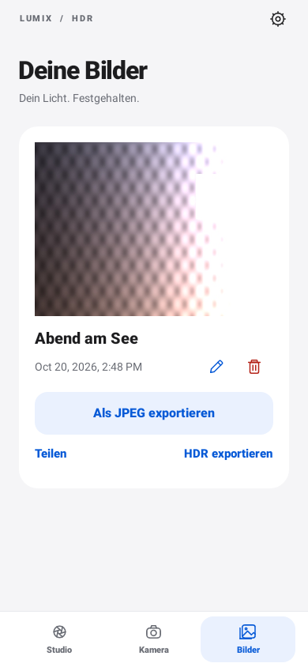

# Lumix HDR Companion 0.3.5

## S9-Verbindung korrigiert: zuerst Bluetooth, dann WLAN

Die Kameraeinrichtung sucht jetzt tatsächlich per BLE nach der S9. Zuvor wurden
nur bereits in Android gekoppelte Geräte aufgelistet. Die App führt nun die aus
LUMIX Lab 3.1.0 abgeleitete Anmeldung mit eigener App-ID durch, liest WLAN-Daten
und Zertifikatsfingerabdruck und öffnet Androids Kamera-WLAN-Verbindungsdialog.
WLAN-Verlust beendet auch die zugehörige Sitzung.

An der Kamera **Bluetooth → Kopplung → Neues Gerät hinzufügen** wählen, dann
in der App **Kamera → Kamera suchen**. Android-Berechtigungen sowie die
Kopplungs-/WLAN-Abfragen bestätigen. Erst nach erfolgreicher HTTPS-Anmeldung
erscheint „Verbunden“.

Anleitung, Build und Grenzen: [S9-Verbindung](docs/S9_CONNECTION.md).
Statische Belege: [Protokollanalyse 0.3.5](docs/PROTOCOL_EVIDENCE_035.md).
Prüfung: [118 Tests erfolgreich, Lint ohne Fehler, APK gebaut](docs/VALIDATION_035.md).
**Ein vollständiger Test an einer echten S9 steht noch aus.**

Der folgende Überblick stammt aus dem veröffentlichten 0.3.4-Stand. Das
Git-Repository enthält derzeit den Android-Teil; mehrere dort erwähnte ältere
Dokumentationen sowie das Python-Paket fehlen im veröffentlichten Quellbaum.

Native Android-App und Python-Desktop-Anwendung für lokale HDR-Verarbeitung.
Das öffentliche Projekt umfasst Quellcode, Tests, Dokumentation, synthetische
Beispielbilder und die bisherigen Prüfberichte.

**[Android-APK und Quellarchiv herunterladen](../../releases/tag/v0.3.4)**



## Quellcode nutzen

```bash
git clone https://github.com/JanWein/lumix-hdr-companion.git
cd lumix-hdr-companion
```

- `android/`: native Android-App, Gradle-Wrapper, Java-Tests und Demo-Assets.
- `lumix_hdr/`: Python-Engine, Kommandozeile und Desktop-Oberfläche.
- `tests/`, `scripts/`, `demo/`: Python-Tests und reproduzierbare Testbilder.
- `docs/`: Bedienung, Kamera-Protokollherkunft, Grenzen und Prüfberichte.
- `LICENSE`, `THIRD_PARTY_NOTICES.md`, `licenses/`: MIT-Lizenz und Fremdlizenzen.

Android-Build mit JDK 17 und installiertem Android-SDK 35:

```bash
cd android
./gradlew testDebugUnitTest lintDebug assembleDebug
```

Unter Windows `gradlew.bat` verwenden. Alternativ `android/` in Android Studio
öffnen. Der TLS-Test erzeugt mit dem JDK-Werkzeug `keytool` einen temporären
Testschlüssel; private Schlüsseldateien werden nicht mitgeliefert. Den eigenen SDK-Pfad lokal über `ANDROID_HOME` oder `local.properties`
setzen. Signierschlüssel und lokale Einstellungen gehören nicht ins Repository.
Der Android-Build ist ein Debug-Prototyp für Android 10 oder neuer (ARM64).
Ein eigener Build verwendet den lokalen Debug-Schlüssel und kann eine mit einem
anderen Schlüssel installierte APK nicht direkt ersetzen.

Python-Installation und Nutzung sind weiter unten beschrieben. Prüfungen:
`python -m pytest -q`. Die Android-App ist Version 0.3.5; das unabhängige Python-
Paket behält seine Version 0.1.0.


Ein lokaler Prototyp für vorhandene JPEG-Belichtungsreihen der Lumix S9 und anderer Kameras. Python-Anwendung für Windows/Linux/macOS sowie native Android-App. Keine Firmware-Veränderung, keine Cloud, kein Abonnement.

## Bilder umbenennen in Android 0.3.4

Unter **Bilder** öffnet das Stift-Symbol einen Namensdialog. Der gespeicherte
Name erscheint am Ergebnis und wird beim JPEG- sowie HDR-Export als Dateiname
vorgeschlagen. Bestehende Ergebnisse funktionieren ohne Migration weiter.
Details: [Bilder umbenennen](docs/RENAME_034.md).

## Bilder löschen in Android 0.3.3

Unter **Bilder** entfernt das Papierkorb-Symbol nach Bestätigung das gewählte
Ergebnis mit JPEG und zugehöriger HDR-Datei aus der App. Originalaufnahmen sowie
Galerie- und Dateiexportkopien bleiben erhalten. Details: [Bilder löschen](docs/DELETE_033.md).

## JPEG-Dateiexport in Android 0.3.2

Unter **Bilder → Als JPEG exportieren** lässt sich jedes Ergebnis als gewöhnliche
JPEG-Datei an einem frei gewählten Ort speichern. Die HDR-Datei bleibt erhalten.
Falls ein Ergebnis nur noch als HDR vorliegt, wird eine JPEG-Version neu erzeugt.
Anleitung und Prüfungen: [JPEG-Export](docs/JPEG_EXPORT_032.md).

## Fehlerkorrektur Android 0.3.1

Der Fehler „EXIF unvollständig“ bei den eingebauten Beispielbildern ist korrigiert.
Die Beispiele enthalten jetzt Android-kompatible EXIF-Typen. Manuelles HDR verlangt
keine für die Gruppierung gedachten Zeit-/Korrekturdaten mehr; alte bereits
importierte Beispieldateien bestehen diese Prüfung ebenfalls. Fehlende echte
Belichtungsdaten führen zu einer verständlichen Meldung mit ausdrücklich wählbarer
JPEG-Fusion. Details und Nachprüfung: [Korrektur 0.3.1](docs/FIX_031.md).

## Neue Oberfläche in Android 0.3

Drei Bereiche: **Studio**, **Kamera** und **Bilder**. Zuerst Fotos auswählen und
in einer Vorschau prüfen, dann bewusst „HDR erstellen“ wählen. Auch Kameraimporte
und geteilte Bilder landen zunächst in dieser Auswahl. Fertige JPEGs lassen sich
teilen; Radiance-Dateien separat exportieren.

Die Gestaltung verwendet eine helle und eine dunkle Palette, große Überschriften,
ruhige Flächen und klare Hauptaktionen. Einstellungen liegen hinter dem Zahnrad,
technische Kameraparameter im separaten Diagnosefenster. Einrichtungsschritte
verschwinden nach erfolgreicher Kameraanmeldung.

Siehe [Design und Bedienung 0.3](docs/DESIGN_03.md). Die darunter dokumentierten
HTTPS-Funktionen aus 0.2 bleiben erhalten; die Anordnung der Bedienelemente hat
sich geändert. Die Hardwaregrenzen gelten weiterhin.

## Neu in Android 0.2

Die vorhandene App ist um die aus LUMIX Lab ermittelte lokale HTTPS-Schnittstelle erweitert:
Anmeldung mit eigener App-ID und Token, Prüfung des Kamerazertifikats, optionales
BLE-Fingerabdrucklesen, Kameraeinstellungen und Auslösen, Galerieauswahl und
JPEG-Downloads in geprüften Teilstücken direkt an die bestehende HDR-Verarbeitung.

**BLE-Registrierung und WLAN-Übergabe sind ab 0.3.5 implementiert; ein erfolgreicher S9-Lauf ist noch offen.**
Eine App-Kopplung mit LUMIX Lab registriert nicht automatisch diese App.

Die vollständige Anleitung steht in [Android 0.2](docs/ANDROID_02.md), die statischen
Belege in [Protokollherkunft](docs/PROTOCOL_EVIDENCE_02.md).

## Weiterhin umgesetzt

- Einzelne Reihen aus 3, 5 oder 7 JPEGs verarbeiten.
- Ordner automatisch auf vollständige Reihen prüfen, anhand EXIF-Zeit, Belichtungsbias, Verschlusszeit, ISO, Blende und Bildgröße.
- Ausrichtung durch OpenCV AlignMTB mit gemeinsamem Bildausschnitt.
- Radiance-HDR über Debevec-Kalibrierung und Zusammenführung, Ausgabe als `.hdr` mit JPEG-Vorschau.
- Alternativ Mertens-Belichtungsfusion als normales SDR-JPEG.
- Originalbilder bleiben unverändert.
- Android: Dateiimport, Android-Teilen, Galerie-Export, HDR-Dateiexport, automatische Überwachung eines ausgewählten Eingangsordners bei geöffneter App und ein experimenteller direkter WLAN-Import.
- Eine künstliche Beispielreihe ist enthalten. Die Android-Schaltfläche „Beispielreihe verarbeiten“ ermöglicht einen Test ohne Kamera.

## Was noch nicht nachgewiesen ist

**Der WLAN-Zugriff auf eine echte S9 wurde nicht getestet.** Die HTTPS-Anbindung implementiert die gefundenen Nachrichten und eine eigene Token-Anmeldung. Version 0.3.5 ergänzt die BLE-Registrierung der eigenen App und die WLAN-Übergabe; die kameraseitige Annahme bleibt am Gerät zu prüfen. Die frühere HTTP-/UPnP-Anbindung ist separat als Legacy-Test erhalten. Es gibt keinen automatischen Protokollwechsel und keine Übernahme einer fremden Lab-Identität.

**Das proprietäre LUMIX SDK ist nicht enthalten oder angebunden.** Panasonic veröffentlicht es für Windows als DLL/Header und verlangt für den Download Modell und Kameraseriennummer. Eine Linux- oder Android-Version ist in der offiziellen Quelle nicht veröffentlicht. Deshalb ruft dieses Projekt keine erfundenen DLL-Funktionen auf. Bereits über LUMIX Tether oder die SDK-Beispielanwendung in einem PC-Ordner gespeicherte JPEGs kann der Watcher verarbeiten; auch dieser Übergabeschritt muss mit der S9 geprüft werden. Siehe [SDK und Android](docs/SDK_ANDROID.md).

## S9 vorbereiten

1. Für den ersten Versuch ein unbewegtes Motiv und möglichst ein Stativ verwenden.
2. A-Modus, feste ISO, feste Blende, fester Weißabgleich. Natürlicher/Standard-Bildstil ohne Real Time LUT ist für Radiance-HDR sinnvoll. Die Annahme einer gemeinsamen Bildantwort muss möglichst gut erfüllt sein.
3. JPEG oder RAW+JPEG einstellen. Auch Version 0.2 verarbeitet ausschließlich JPEG, nicht RW2.
4. Belichtungs-Bracketing: 3 Bilder mit 1 EV Abstand, vollständige Reihe mit einem Auslösen. Später sind auch 5/7 Bilder und 1/3 oder 2/3 EV möglich.
5. Neue Reihen beim ersten Test mit einigen Sekunden Abstand aufnehmen. Keine anderen Bilder in dieselbe Reihe mischen.

Die Erkennung ist eine konservative EXIF-Heuristik, keine Auswertung eines von Panasonic garantierten Bracket-Identifikators. Ähnlich belichtete, schnell nacheinander aufgenommene Einzelbilder können als Reihe erkannt werden. Unvollständige oder stark abweichende Reihen werden ausgelassen. 8 Sekunden ist der maximale Zeitabstand zwischen zwei Bildern; für Langzeitaufnahmen `--max-gap` anpassen.

## Desktop installieren und starten

Python 3.10 oder neuer:

```bash
python -m venv .venv
# Linux/macOS:
source .venv/bin/activate
# Windows PowerShell alternativ:
# .venv\Scripts\Activate.ps1
python -m pip install .
lumix-hdr gui
```

Unter Linux benötigt die Oberfläche gegebenenfalls das OS-Paket `python3-tk`. Die Kommandozeile funktioniert ohne Oberfläche.

```bash
# Einmal automatisch nach vollständigen Reihen suchen:
lumix-hdr scan /pfad/zu/jpeg --output /pfad/zu/hdr --count 3 --step 1

# Neue Reihen im Eingangsordner automatisch verarbeiten:
lumix-hdr watch /pfad/zu/jpeg --output /pfad/zu/hdr --count 3 --step 1

# Eine bekannte Reihe gezielt zusammenführen:
lumix-hdr merge bild1.jpg bild2.jpg bild3.jpg --output hdr-output

# Fusion benötigt bei gezielter Auswahl keine Belichtungsmetadaten:
lumix-hdr merge bild1.jpg bild2.jpg bild3.jpg --output fusion --mode fusion

# Synthetische Beispielreihe:
lumix-hdr scan demo --output demo-output --no-align
```

Die maximale Kantenlänge ist auf dem Desktop standardmäßig 2400 Pixel. `--max-side 0` verarbeitet die volle Auflösung und benötigt entsprechend mehr Speicher. `--no-align` ist für bereits ausgerichtete Bilder möglich. Der Watcher prüft alle drei Sekunden, ignoriert ganz neue Dateien zunächst zwei Sekunden und verwendet atomare Ausgabedateien. Eine JSON-Datei protokolliert die Quellen und Einstellungen. Gleiche Dateien mit gleichen Einstellungen werden nicht erneut verarbeitet. Nur ein Watcher je Ausgabeverzeichnis verwenden. Übertragungsprogramme sollten zuerst `.partial` schreiben und erst nach Abschluss auf `.jpg` umbenennen.

## Android nutzen

Android 10 oder neuer, ARM64. Die APK ist ein lokal signierter Debug-Prototyp für Tests. Keine Play-Store-Veröffentlichung.

1. APK auf dem Telefon installieren. Wenn Android danach fragt, die Installation für diese Datei freigeben.
2. Zuerst „Mit Beispielbildern ausprobieren“ und anschließend „HDR erstellen“ testen. Die Beispielszene ist ein künstliches Testmuster, keine Fotografie.
3. Eine komplette JPEG-Reihe auf das Telefon übertragen und im Studio über „Fotos auswählen“ auswählen. Alternativ aus einer anderen App mehrere Bilder an Lumix HDR teilen, falls diese App das unterstützt.
4. Die Vorschau prüfen und die Ausgabe wählen. Erst „HDR erstellen“ startet die Verarbeitung. Bei 3, 5 oder 7 bewusst ausgewählten Aufnahmen wird eine Reihe verarbeitet; bei anderen Anzahlen greift die EXIF-Gruppierung.
5. Das JPEG erscheint unter `Pictures/LumixHDR` in der Galerie und im Bereich Bilder. Über „Teilen“ weitergeben oder die Radiance-Datei über „HDR exportieren“ sichern.

Für die Ordner-Automatik „Eingangsordner wählen“ und „Ordner-Automatik starten“ verwenden. Die App muss im Vordergrund geöffnet bleiben. SAF-Ordnerzugriff erlaubt keine automatische Übernahme beliebiger privater Ordner von LUMIX Lab. Verwende einen über Android auswählbaren Ordner oder die Dateiauswahl. Dass Lab automatisch in einen frei wählbaren Ordner exportiert, wird nicht vorausgesetzt.

Android begrenzt die Ausgabe bewusst auf maximal 1600 Pixel Kantenlänge, damit 5/7 Aufnahmen nicht unkontrolliert viel Arbeitsspeicher verbrauchen. Eingangsdateien werden privat gespeichert und verbleiben bis zum Löschen der App-Daten. Die Verarbeitung läuft in einem Hintergrundthread der geöffneten Activity, nicht als dauerhafter Android-Hintergrunddienst. Beim Bildschirmdrehen oder Schließen laufende Verarbeitung nicht als abgeschlossen voraussetzen. Es gibt in 0.1 noch keine Fortschrittsanzeige je Pixel, Abbruchfunktion oder Wiederaufnahme nach Prozessende.

### Älteren WLAN-Adapter separat prüfen

Für die neue HTTPS-Anbindung zuerst [Android 0.2](docs/ANDROID_02.md) lesen. Der folgende Abschnitt beschreibt nur den erhaltenen Legacy-Adapter.

1. Kamera für eine Smartphone-WLAN-Verbindung vorbereiten.
2. In den Android-WLAN-Einstellungen mit dem Kamera-WLAN verbinden und „ohne Internet verbunden bleiben“ bestätigen, falls Android danach fragt. Andere Fernsteuerungs-Apps zuvor schließen.
3. Die Kamera-IP prüfen, Vorgabe `192.168.54.1` ist nur ein häufiger Ausgangswert.
4. „Alte WLAN-API testen“ wählen. Eine Bestätigung auf der Kamera kann nötig sein.
5. Bei unterstützter älterer API lädt der Client Original-JPEGs aus den **ersten 30 Einträgen der von der Kamera gelieferten Medienliste**. Die Reihenfolge wird nicht als „neueste zuerst“ garantiert. Die EXIF-Gruppierung erzeugt danach automatisch Bilder aus vollständigen Reihen.
6. Der Zugriff schaltet kurz in Wiedergabe und versucht danach, in den Aufnahmemodus zurückzukehren. Nicht während einer Aufnahme ausführen. Es wird nichts auf der Kamera gelöscht.

Falls die Kamera die Anmeldung ablehnt, ist der direkte Weg mit diesem Prototyp nicht bestätigt. Dateiimport funktioniert unabhängig davon. Die neue HTTPS-Anbindung ist in 0.2 separat vorhanden. Für beide Wege bleiben Tests an der S9 mit genauer Firmwareversion erforderlich, ohne WLAN-Passwort oder Sitzungstoken weiterzugeben.

## HDR bedeutet hier

Die `.hdr`-Datei enthält Fließkomma-Radiance im Radiance-RGBE-Format. Das JPEG ist eine tonemapped SDR-Vorschau. Es ist **kein Ultra-HDR-JPEG mit Gain Map** und bewirkt keine garantierte HDR-Anzeige in Android-Fotogalerien. Mertens fusioniert mehrere Belichtungen direkt zu einem SDR-Bild und erzeugt kein radiometrisches HDR.

Keine Deghosting-Funktion: bewegte Menschen, Blätter, Wasser und starke Parallaxe können Doppelkonturen erzeugen. AlignMTB korrigiert Translation, keine vollständigen Perspektivänderungen. Aus JPEGs mit lokalen Tonwertkorrekturen oder unterschiedlichen Bildstilen lässt sich keine verlässliche physikalische Radiometrie ableiten. RAW-Verarbeitung, Ultra HDR, USB/PTP auf Android und durch Hardwaretests verifizierte S9-Authentifizierung sind auch in 0.2 noch offen.

## Entwicklung

```bash
python -m pip install . pytest
python -m pytest -q
```

Android: den Ordner `android` in Android Studio öffnen, JDK 17, Android SDK 35 und Build Tools 35 installieren. Mit dem mitgelieferten Gradle-Wrapper:

```bash
cd android
./gradlew testDebugUnitTest lintDebug assembleDebug
```

Kein Panasonic-Code wird mitgeliefert. Das Projekt steht unter MIT; Abhängigkeiten haben eigene Lizenzen. Siehe [Quellen](docs/SOURCES.md) und [Validierung](docs/VALIDATION.md).
